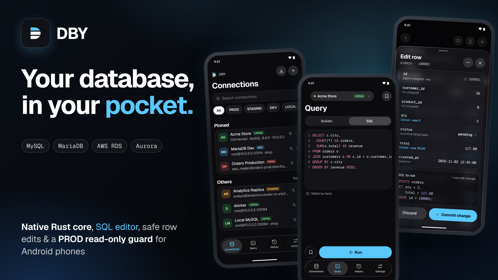
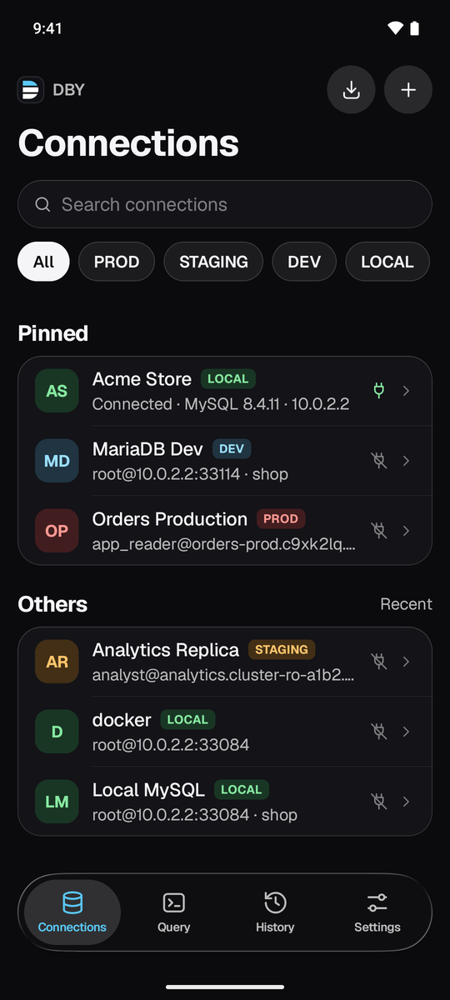
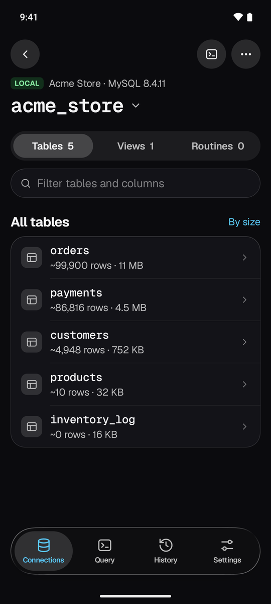
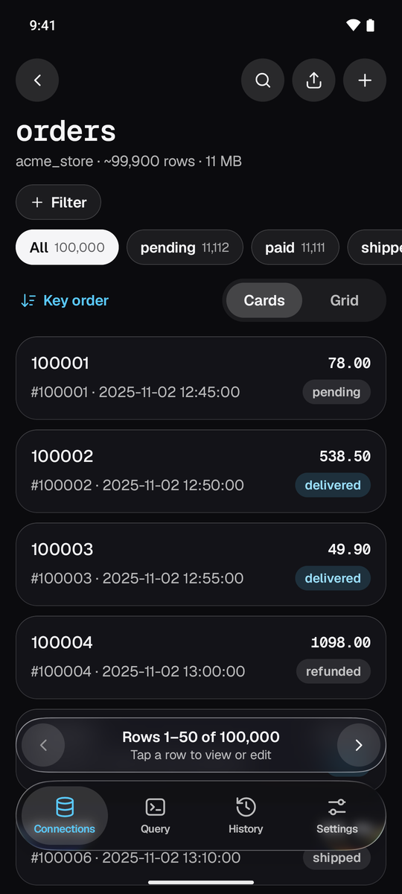
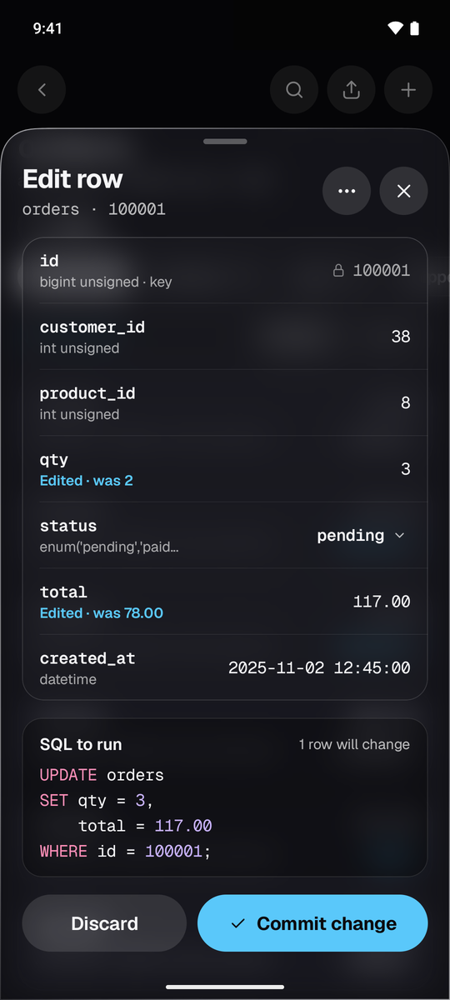
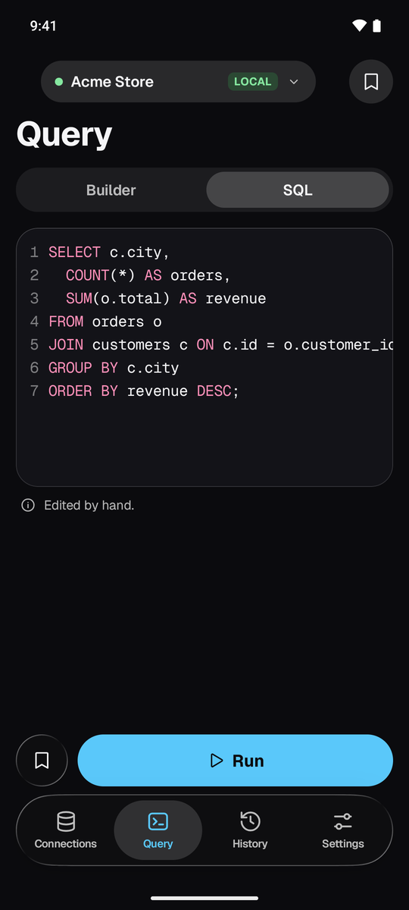
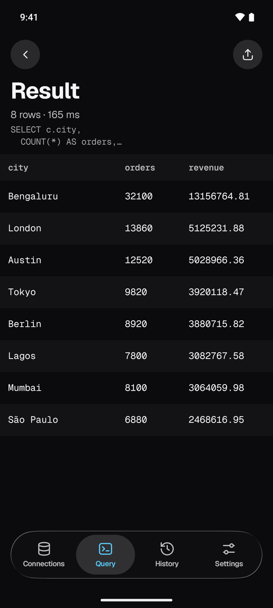

<p align="center"></p>

<h1 align="center">DBY: Fast MySQL & MariaDB Client for Android</h1>

<p align="center"><b>Your database, in your pocket.</b> A fast, free and open source MySQL client app for Android phones. Browse tables, run SQL queries, edit rows and export CSV from AWS RDS, Aurora, MariaDB or any MySQL server, right from your phone.</p>

<p align="center"><a href="https://github.com/yashoncode/dby/releases/latest"><b>⬇ Download the latest DBY APK</b></a></p>

<p align="center"></p>

## Features

- ⚡ **Fast.** A native Rust core talks the MySQL wire protocol directly. No JDBC, no WebView. Tables open and scroll quickly, even over mobile data to AWS RDS.
- 🗂️ **Schema explorer.** Databases, tables, columns and indexes, cached so they appear immediately. Pin the tables you use most.
- 📊 **Table data, cards or grid.** Smooth paging through millions of rows, with filters, facets, sort and CSV export.
- ✍️ **Run SQL queries.** A SQL editor with syntax colouring, a visual query builder, query history and cancel. Copy any field or whole row, or export results to CSV and JSON.
- ✏️ **Edit rows safely.** Insert, update, duplicate and delete rows. Every write shows the exact SQL before it runs.
- 🛡️ **PROD read-only guard.** Tag connections as PROD, STAGING, DEV or LOCAL. Production connections stay read-only until you unlock them.
- 🔢 **Exact values.** BIGINT, DECIMAL and long text are never rounded or cut off.
- 🔐 **Secure.** TLS connections. Passwords are encrypted with the Android Keystore. Fingerprint app lock.
- 📥 **Import connections** from a dbx export, plain or passphrase-encrypted.
- 💎 **Frosted glass design** with a dark theme, accent colours and haptics.
- 🔄 **Updates itself** from GitHub Releases. No Play Store needed.

## Screenshots

<p align="center">
  
  
  
</p>
<p align="center">
  
  
  
</p>

## Works with

MySQL 5.7 and 8.x, MariaDB 10.x and 11.x, Amazon RDS for MySQL, Amazon Aurora MySQL, Google Cloud SQL for MySQL, Azure Database for MySQL, PlanetScale, DigitalOcean Managed MySQL and self-hosted MySQL servers. You need a direct TCP connection to the server (SSH tunnels are not supported yet).

## Download

Get the APK from [Releases](https://github.com/yashoncode/dby/releases/latest): `dby-<version>.apk`.

Android 8.0 or later. After the first install, DBY updates itself from inside the app.

## Build

```
cd android
./gradlew :app:assembleDebug     # debug, for testing
./gradlew :app:assembleRelease   # release, signed with the local release key if present
```

The Android app is Kotlin and Jetpack Compose. The database core is Rust (`core/`, using `mysql_async`, `rustls` and `tokio`), called from Kotlin through UniFFI. Building needs the Android NDK and a Rust toolchain with the Android targets.

## FAQ

**Is there a good MySQL client for Android?** DBY is a free, open source MySQL and MariaDB client built for phones, with a native core for speed.

**Can I connect to AWS RDS from my Android phone?** Yes. Enter the RDS endpoint, port 3306, user and password. The RDS instance must allow connections from your network.

**Is it safe to use on a production database?** PROD connections are read-only by default, and every write shows its SQL before it runs.

**Is DBY free?** Yes, free with no ads and no tracking.

## Support

DBY is free and always will be. If it has saved you a trip back to the laptop and you feel like saying thanks, you can [buy me a coffee](https://buymeacoffee.com/yashwynth) ☕. No pressure at all. A star on GitHub or a bug report helps just as much.

